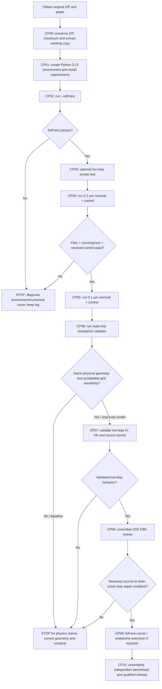

# 4H-SiC Vertical JFET: Setup, Execution, Checkpoint and Risk-Mitigation Guide

**Project:** KEM 948 / Figures 5.1–5.2 — reduced Python drift–diffusion simulation  
**Reference paper:** Monaghan, Martinez, Fisher & Jennings, *Impact of Dimensions and Doping on the Breakdown Voltage of a Trench 4H-SiC Vertical JFET*, *Key Engineering Materials* 948 (2023), pp. 69–75, DOI `10.4028/p-e6c13m`.  
**Runbook version:** 1.0 — 21 October 2026  
**Audience:** device simulation researchers, Python users, reviewers and engineers developing a more physically faithful solver.  
**Companion tool:** `JFET_Checkpoint_Validator.py` (read-only checks of outputs and baseline limitations).

> **Qualification warning:** This is a guide to **run and verify the supplied reduced electron-only Python simulation**, **not** a recipe for recreating the paper's proprietary Sentaurus results. Its baseline solves coupled Poisson/electron drift–diffusion but does not reproduce Figure 5.1's source-to-drain DIBL failure at about 200 V, and it cannot model Figure 6's avalanche at approximately 1800 V. A working execution does not mean that the device physics has been validated.

## 1. What this guide delivers

At the end of the **baseline execution path**, you should have:

1. An unchanged copy of the original archive and a working extraction.
2. A reproducible, isolated Python environment and a passing solver self-test.
3. The **coarse** (`0.2 µm`) and **fine** (`0.1 µm`) simulation datasets for both the nominal approximate paper bias and an on-state numerical control.
4. Maps, field arrays, residual histories, metrics, and a machine-readable checkpoint assessment.
5. A documented **GO / NO-GO decision**. You should expect numerical checks to pass but **physical/geometry validation to remain blocked** on the as-received model.

This guide also defines a **separate improvement path** from geometry correction to DIBL and, eventually, full avalanche physics. Those improvement checkpoints are *plans*, not code already implemented in the provided archive.

### 1.1 Source-of-truth files

| File | Purpose | Run directly? |
|---|---|---|
| `kem948_fig5_package.zip` | Supplied solver, dependencies, data, figures and report | Extract first |
| `simulate_kem948_fig5.py` | **Primary simulation**; `--self-test`, `--mesh`, `--gate`, `--drain`, `--control`, `--output` | Yes |
| `requirements_kem948.txt` | Top-level pinned Python package versions | Install |
| `build_kem948_package.py` | Rebuilds KEM technical report/ZIP; `--rerun` also recomputes all four cases | Optional, **overwrites generated material** |
| `kem948_fig5_results/` | Packaged fine-grid numerical outputs | Inspect / compare |
| `kem948_fig5_results/coarse/` | Packaged coarse-grid numerical outputs | Inspect / compare |
| `kem948_fig5_report/manifest.json` | SHA-256 hashes of the original payload files | Verify **before** rerunning |
| `kem948_fig5_technical_report.pdf` | Original reduced-model derivation and limitations | Read |
| `JFET_Simulation_Improvement_Proposal.md` | Previously prepared plan to correct the solver | Read for future implementation |
| `JFET_Checkpoint_Validator.py` | Companion runbook checker; **not inside the original ZIP** | Optional / recommended |

Other `simulate_fig7*`, `jfet_pinch_off*`, `direct_2d_poisson_results/` files concern earlier or different studies; **do not confuse them with the Figure 5 solver**. Sentaurus is **not required** for this Python package. A true Sentaurus reproduction would be a separate project with additional data/licensing requirements.

## 2. Operating workflow / decision flow



**Interpretation of STOP:** The code can still be useful for teaching and reduced-model experiments. STOP means *do not advance a physical validation claim or calibrate new physics to conceal an upstream defect*.

## 3. Requirements and practical prerequisites

- **Operating system:** Windows 11 PowerShell or Linux/macOS terminal. The submitted report documents a tested Windows 11 / Python **3.13.14** environment; the audit exercised Python **3.13.5** on Linux. **Other systems are not fully certified.**
- **Python:** **3.13 recommended** for best compatibility with the delivered pinned requirements. The script syntax targets 3.10+, but do **not** assume the pinned dependency set has been tested on 3.10–3.12.
- **Packages (from the supplied file):** `numpy==2.4.4`, `scipy==1.17.1`, `matplotlib==3.10.8`, `reportlab==4.4.10`, `markdown-it-py==4.0.0`.
- **System resources:** A desktop/laptop with sufficient free RAM and storage for sparse matrix solves and plot generation. The fine case has approximately **11,070 active unknowns**; runtime and RAM vary substantially by machine and available optimized numerical libraries. Budget additional time for the high-bias solve (about 600 Gummel iterations in the supplied results). **Do not assume a short runtime or a fixed timeout.**
- **Downloads:** Obtain `kem948_fig5_package.zip`, the original `KEM.948.69.pdf`, and optionally the companion checkpoint validator. Internet may be required for one-time `pip install` unless wheels are pre-cached. No network is required for the solver once dependencies are installed.

### 3.1 Suggested workspace layout

Create a **separate working copy**, keeping the original ZIP intact:

```text
JFET_project/
  kem948_fig5_package.zip             # original, unchanged
  KEM.948.69.pdf                      # paper, unchanged
  JFET_Checkpoint_Validator.py        # optional companion download
  jfet_working_copy/                  # ZIP extracted here
    simulate_kem948_fig5.py
    build_kem948_package.py
    requirements_kem948.txt
    kem948_fig5_results/              # original packaged outputs
    kem948_fig5_report/
    .venv/                             # created in CP01
    runs/                              # NEW case-specific outputs
  checkpoints/                        # optional exported JSON/logs
```

Never use `kem948_fig5_results/` as the output folder for experiments if you want to preserve the supplied reference datasets. Archive your original ZIP outside your development branch and record its SHA-256 hash.

## 4. CP00 — Freeze the original baseline and extract it

**Goal:** Prove that you are starting from the supplied package and avoid accidental overwrites.

### Windows PowerShell

From the folder containing `kem948_fig5_package.zip`:

```powershell
py -3.13 --version
Get-FileHash .\kem948_fig5_package.zip -Algorithm SHA256
py -3.13 -m zipfile -t .\kem948_fig5_package.zip
py -3.13 -m zipfile -e .\kem948_fig5_package.zip .\jfet_working_copy
cd .\jfet_working_copy
Get-ChildItem simulate_kem948_fig5.py, requirements_kem948.txt, build_kem948_package.py
```

### Linux/macOS (bash/zsh)

```bash
python3.13 --version
shasum -a 256 kem948_fig5_package.zip   # sha256sum also works on many Linux systems
python3.13 -m zipfile -t kem948_fig5_package.zip
python3.13 -m zipfile -e kem948_fig5_package.zip jfet_working_copy
cd jfet_working_copy
ls -l simulate_kem948_fig5.py requirements_kem948.txt build_kem948_package.py
```

`-t` should report no corrupt member; `-e` extracts the archive. Record the checksum you obtain locally; this guide does **not** prescribe an invented reference checksum.

**Optional full payload hash validation:** once Python dependencies and the validator are installed (CP01), run `JFET_Checkpoint_Validator.py --verify-manifest` **before** changing or regenerating any packaged outputs. On the as-received uploaded archive, **94/94** manifest-listed payload hashes passed the audit.

**GO:** ZIP test passes; expected scripts/requirements exist; original is retained.  
**STOP:** archive test fails, source files missing, or origin cannot be established. Re-download / recover original; do not repair source files silently.

## 5. CP01 — Create an isolated environment and install dependencies

Do **not** rely on globally installed NumPy/SciPy; version differences can change solver numerics and reproducibility.

### Windows PowerShell (inside `jfet_working_copy`)

```powershell
py -3.13 -m venv .venv
.\.venv\Scripts\python.exe -m pip install --upgrade pip
.\.venv\Scripts\python.exe -m pip install -r requirements_kem948.txt
.\.venv\Scripts\python.exe -m pip check
.\.venv\Scripts\python.exe --version
.\.venv\Scripts\python.exe -m pip freeze > installed_environment.txt
```

### Linux/macOS (inside `jfet_working_copy`)

```bash
python3.13 -m venv .venv
./.venv/bin/python -m pip install --upgrade pip
./.venv/bin/python -m pip install -r requirements_kem948.txt
./.venv/bin/python -m pip check
./.venv/bin/python --version
./.venv/bin/python -m pip freeze > installed_environment.txt
```

No environment activation is required. **For all subsequent commands use your environment's Python executable**:

| Platform | Substitute for `PYTHON` below |
|---|---|
| Windows PowerShell | `.\.venv\Scripts\python.exe` |
| Linux/macOS | `./.venv/bin/python` |

When copying a `PYTHON ...` example, replace the literal `PYTHON` with the full command shown in the table. `installed_environment.txt` records actual package versions; it is *not* a fully frozen transitive lockfile.

**GO:** installation completed with exit code `0`; `pip check` passes; the virtual environment uses Python 3.13.  
**STOP / mitigation:** `No module named ...` means the commands are using the wrong interpreter or install failed; re-run `-m pip` with the same `.venv` interpreter. If pinned wheels are unavailable for your platform, record the problem and either use a supported 3.13 system or create a **separately labeled** compatibility experiment; do not quietly relax versions and label results identical.

## 6. CP02 — Test solver installation and numerical integrity

**First inspect the actual supported options:**

```bash
PYTHON simulate_kem948_fig5.py --help
```

The verified CLI is:

```text
--self-test
--mesh MESH            # 0 < spacing <= 0.25 µm
--drain DRAIN          # V; default 200
--gate GATE            # V; default -20
--control              # ALSO runs VGS=0 V, VDS=1 V AFTER the requested main case
--output OUTPUT        # destination directory
```

**Run the built-in self-test:**

```bash
PYTHON simulate_kem948_fig5.py --self-test
```

Expected output is a JSON object containing `"equilibrium_flux_identity": "PASS"`, `iterations` near **265**, `poisson_residual` below **2e-6 V**, a resolved control current close to **1.0282e-5 A/µm** on the documented `0.2 µm` mesh, and relative `terminal_imbalance` below **1e-5**. Last digits can differ by installed BLAS/platform. The self-test **checks a numerical identity and one control state only**; it does not test implant fidelity or DIBL.

**Verification performed for this runbook:** the supplied source self-test completed using Linux / Python 3.13.5 and passed the equilibrium-flux identity and source/drain current-balance conditions.

**GO:** process exit `0`, no exceptions, `PASS`, positive/nonfinite density checks satisfied.  
**STOP:** any exception, `NaN`, negative densities, failed conservation, or nonconvergence. Save full stdout/stderr and environment versions before modifying code.

## 7. CP03 — Run a low-voltage smoke case *before* high-voltage work

This is a **recommended operation order** (not a change to the paper). It checks that result writing and plotting work without first asking for the difficult nominal high-bias solve.

```bash
PYTHON simulate_kem948_fig5.py --mesh 0.2 --gate 0 --drain 1 --output runs/CP03_smoke_0V_1V
```

**IMPORTANT label behavior:** custom bias settings cause the script to write files starting with `user_bias_`, for example:

```text
runs/CP03_smoke_0V_1V/
  user_bias_metrics.json
  user_bias_convergence.csv
  user_bias_fields.npz
  user_bias_centerline.csv
  user_bias_maps.png
  user_bias_maps.pdf
  user_bias_convergence.png
  user_bias_convergence.pdf
```

Check `user_bias_metrics.json` for `"gate_v": 0.0`, `"drain_v": 1.0`, `"current_resolved": true`; check the plot is actually written and both nonlinear stopping metrics in the final convergence CSV are below `2e-6 V`. Do not confuse this exploratory `user_bias` label with the official `on_state_control` output produced by `--control`.

**GO:** all eight files exist, bias matches, control current is resolved, and numerical stopping criteria pass.  
**STOP:** missing plot/data, stale files, nonconvergence, incorrect bias/mesh. Do not proceed to high voltage until the output pipeline is working.

## 8. CP04 — Run the official coarse-grid nominal + control cases

```bash
PYTHON simulate_kem948_fig5.py --mesh 0.2 --control --output runs/CP04_coarse
```

`--control` does **not** mean “only run control.” It first runs the **nominal requested bias** (`VGS=-20 V`, `VDS=200 V` by default), then runs the **on-state control** (`VGS=0 V`, `VDS=1 V`). It can therefore take considerably longer than a low-bias smoke case.

Expected prefixes in `runs/CP04_coarse/`:

- `paper_bias_approximation_*` — nominal `(-20 V, 200 V)` reduced-model run.
- `on_state_control_*` — numerical control `(0 V, 1 V)`.

For each prefix, the solver writes: `*_metrics.json`, `*_convergence.csv`, `*_fields.npz`, `*_centerline.csv`, `*_maps.png/.pdf` and `*_convergence.png/.pdf` (**16 files total** for the two cases).

**What the packaged as-received coarse solution reports:** about **608 iterations** nominal, **265 iterations** on-state; cell-centered peak field **0.733 MV/cm** at nominal bias; current at nominal bias **unresolved**; on-state drain current approximately **1.0282e-5 A/µm**. These are *reference expectations*, not absolute bitwise pass conditions or independent physical validation.

**GO — operational only:** output files readable; both cases satisfy residual + undamped correction `< 2e-6 V`; the control current is resolved and the relative source/drain imbalance `< 1e-5`.  
**KNOWN PHYSICAL BLOCKER:** coarse mesh has **4 left/right gate-mask mismatches** in the supplied model. Never interpret its asymmetry as the paper's physically asymmetric Monte Carlo implants.

## 9. CP05 — Run the official fine-grid nominal + control cases

```bash
PYTHON simulate_kem948_fig5.py --mesh 0.1 --control --output runs/CP05_fine
```

Use a **new** output directory and do not delete the coarse case. The as-received fine-grid metrics are:

| Fine-grid (0.1 µm) metric | Nominal −20 V / 200 V | Control 0 V / 1 V |
|---|---:|---:|
| Active unknowns | 11,070 | 11,070 |
| Iterations | 604 | 210 |
| Integrated Poisson residual (V) | 1.203e-9 | 1.866e-6 |
| Maximum cell-centered field (MV/cm) | 0.868 | 0.0936 |
| Maximum gate-face field estimate (MV/cm) | 1.166 | 0.137 |
| Centerline barrier relative to drift (eV) | 3.857 | 0 |
| Drain current (A/µm) | **Unresolved** | **8.83e-6** |

These numerical reference values come from the supplied report and audit; they are not the paper's Sentaurus values.

**GO — operational only:** both output sets exist, numerical stopping criteria pass, control terminal balance passes.  
**NO-GO for physical reproduction:** a nominal current display marked unresolved is **not** a demonstration of near-zero physical leakage; it is not Figure 5.1's source-to-drain breakdown current. Do not replace it with a raw floating-point number and call it physical leakage.

## 10. CP06 — Inspect and validate output artifacts

### 10.1 What to open, and in what order

1. `*_metrics.json` — confirm **actual applied biases**, mesh, convergence, `current_resolved`, currents, field peaks and barrier.
2. `*_convergence.csv` / `*_convergence.png` — inspect integrated Poisson residual and **undamped** potential correction. A small *damped* step alone is not sufficient.
3. `*_fields.npz` — inspect potential `potential_v`, density `density_cm3`, `ex_v_cm`, `ey_v_cm`, `jx_a_cm2`, `jy_a_cm2`, `active_mask`, `gate_mask`, and `x_um`, `y_um`.
4. `*_maps.png` — inspect current, field and potential side by side; the **upper 6 µm** is plotted even though the computational domain spans **13 µm**.
5. `*_centerline.csv` — inspect a center-column diagnostic; it is **not automatically the true 2-D injection saddle/barrier**.

Units: `x_um,y_um` in µm; `potential_v` in V; `density_cm3` in cm⁻³; fields in V/cm; current density in A/cm²; terminal currents in **A/µm out-of-plane width**. The paper's Figure 4 reports **A**, not A/µm, so absolute terminal current is **not directly comparable** without an independently sourced width/area factor.

### 10.2 Run the companion validator (recommended)

Copy/download **`JFET_Checkpoint_Validator.py`** into the working copy root. The tool **reads only**; it does not alter simulation source or outputs.

**On the untouched extracted original**, after CP01 and before any original-result overwrite:

```bash
PYTHON JFET_Checkpoint_Validator.py --root . --verify-manifest
```

**After running CP04 / CP05 into their own directories:**

```bash
PYTHON JFET_Checkpoint_Validator.py --root . --coarse runs/CP04_coarse --fine runs/CP05_fine --json runs/checkpoints.json
```

**To ask the validator to rerun the built-in self-test:**

```bash
PYTHON JFET_Checkpoint_Validator.py --root . --coarse runs/CP04_coarse --fine runs/CP05_fine --run-self-test --json runs/checkpoints.json
```

`--strict` makes the validator exit with a failure status if the **known geometry or physical-reproduction blockers** remain; this is intentional and expected on the unmodified package. Without `--strict`, the process can exit 0 after numerical checks while clearly printing `BLOCKED`, `NOT VALIDATED` and `NOT AVAILABLE` statuses. **Read statuses, not only exit code.**

If you did **not** generate both runs yet, omit `--coarse/--fine`: it defaults to the saved `kem948_fig5_results/coarse` and `kem948_fig5_results` shipped in the ZIP. **Do not apply `--verify-manifest` after re-generating the originals**, because their new hashes may legitimately differ; retain the original extraction/checksum as the baseline integrity evidence.

### 10.3 Expected checkpoint-status interpretation on the as-received package

| Check | As-received result | Meaning |
|---|---|---|
| Original archive/payload manifest | PASS, 94/94 payload hashes (audited archive) | Integrity only |
| Environment | Install required; compare versions | Necessary prerequisite |
| Solver self-test | PASS when verified | Numerical regression check |
| Coarse/fine saved convergence and control current | PASS | Consistency of reduced equations |
| Mirror geometry / same-device mesh study | **BLOCKED** | Coarse implant 0.4 µm vs fine 0.5 µm; coarse asymmetric mask |
| Nominal Figure 5.1 DIBL current | **NOT VALIDATED** | Both meshes mark current unresolved |
| Figure 6 avalanche | **NOT AVAILABLE** | Electron-only solver has no hole or impact-ionization physics |

## 11. CP07 — Compare with the actual paper, not just the plots

### 11.1 Paper operating points and modeling requirements

| Observable | Paper | Supplied Python implementation |
|---|---|---|
| Material | 4H-SiC | 4H-SiC-inspired material constants |
| Drift doping | `4e15 cm^-3` (±20% study) | `4e15 cm^-3` by default |
| Pillar width | `2.4 µm` for Figures 4–6 | `2.4 µm` by default |
| P+ implant | Monte Carlo Al profile, ~`0.5 µm` deep, near-surface ~`1e19 cm^-3` | Abrupt rectangular **excluded/equipotential** region, assumed encroachment |
| Drift thickness | `11 µm` | 11 µm below an **assumed** 2 µm trench/pillar section |
| `Vth` | Around `-3 V`; extraction at `VDS=1 V`, maximum-transconductance method | No equivalent validated threshold extraction built into CLI |
| DIBL failure | `VGS=-20 V`; **approximately** 200 V onset; source-to-drain current; peak field **<1 MV/cm** | Runs nominal 200 V, **does not resolve** source-to-drain failure current |
| Avalanche failure | `VGS=-60 V`; about 1800 V, gate/drain avalanche; field ~3 MV/cm | **Cannot simulate**; lacks two-carrier and ionization models |

The **exact VDS value for the Figure 5 snapshot is not tabulated in the paper**. `200 V` is the text's approximate onset, not an exact figure annotation. The field color scale extending to `3 MV/cm` in Figure 5.2 is **not evidence that Figure 5.2 reached 3 MV/cm**; the text says its peak was below 1 MV/cm.

### 11.2 Key comparison blockers

- **Mesh geometry defect:** the original `0.2 µm` cell-center masking creates an unintended one-sided gate difference. The `0.2 µm` representation gives **0.4 µm** realized gate depth, while the `0.1 µm` representation gives **0.5 µm**. The comparison is *not* a fixed-geometry convergence study.
- **Boundary assumptions:** N+ source doping/thickness, trench pitch/depth and gate built-in offset are not taken from complete Sentaurus decks; the first/last **cell-center** rows are contacts, not boundary faces.
- **Peak-field ambiguity:** at fine nominal bias the cell-field diagnostic is **0.868 MV/cm**, but the separate gate-face estimate is **1.166 MV/cm**. Neither is a physically converged gate-corner peak.
- **Physics gap:** no acceptor distribution inside P+, no holes, no SRH/Auger recombination, no Fermi–Dirac statistics, and no Okuto–Crowell avalanche.
- **Unknown area factor:** `A` and `A/µm` are not equivalent without device geometry/current normalization.

**GO for baseline reporting:** state *“reproducible reduced-model solution with clearly reported limitations.”*  
**STOP for a reproduction claim:** do not claim reproduced Figure 5 current, reproduced breakdown voltage, or validated device design on the basis of the present outputs.

## 12. CP08–CP10 — Guided improvement path with technical acceptance gates

**These stages require future code/data work. The original package does not implement these changes.** Each stage is a separate commit or tagged checkpoint, with a test report that can be independently checked.

| Stage | Implement | Required test / acceptance gate | Escalation if failed |
|---|---|---|---|
| **I1 — Geometry (critical)** | Define physical interfaces once; construct symmetric/cut-cell or interface-aligned mesh; deterministic mask classification | Same declared implant depth and neck on all meshes; zero accidental left/right mismatches; ±`1e-10 µm` parameter perturbation must not change topology | STOP all physical fitting; fix geometry kernel |
| **I2 — Contacts / electrostatics** | Source and drain contact faces; source electrochemical potential; gate P+/N boundary and documented built-in reference | Equilibrium test, potential-reference consistency, field/flux orientation, Poisson boundary tests | Correct contacts before re-fitting channel barrier |
| **I3 — Numerical robustness** | Scaling, analytic equilibrium, SG flux checks, low-current diagnostics, bias continuation | For **resolved** current, terminal mismatch `<1e-5`; 10× tighter tolerances change key outputs `<1%`; residual + undamped step pass | Improve numerical variables/solver; do not mask raw current noise |
| **I4 — Three-grid convergence** | At least **three grids for one physical geometry**, local gate/corner refinement | Relevant current and source-referenced barrier change `<2%` between two finest meshes; physically sampled field `<5%` | Refine consistent geometry or reconsider corner representation |
| **I5 — Defensible doping** | Obtain actual Monte Carlo Al profiles; if unavailable, bracket documented implant/profile families | Profile provenance, realized minimum P+/P+ gap, left/right realization, parameter sensitivity | Declare uncertainty; cannot claim exact paper-deck reproduction |
| **I6 — Low-bias characterization** | `VDS=1 V` gate sweep and `0–10 V` drain sweeps for widths/doping from paper | Reproduce extraction **method** for `Vth` and Figure 3 trends; show interpolation, mesh and bias-step sensitivity | Fix current injection, contacts and mobility first |
| **I7 — DIBL** | Bias continuation at `VGS=-20 V`, resolved injection barrier, current maps and path identification | Resolved **source-to-drain** current onset and barrier lowering; compare onset **approximately** 200 V with uncertainty and correct mechanism | Do not add avalanche merely to force a current spike |
| **I8 — Avalanche (optional)** | Full electron/hole continuity, generation/recombination, validated Okuto–Crowell parameters | Gate-to-drain impact-generation map, field and carrier-current mechanism; reproduce Figures 4/6 only if all parameter decks are defensible | Limit scope to a validated DIBL study |
| **I9 — Release** | Independent benchmark, uncertainty budget, code/data manifest, fixed cases | Every physical claim linked to inputs, figures, solver evidence, limitations and an explicit operating point | Label as exploratory, not a design predictor |

**The percentages and numerical tolerance gates above are proposed engineering acceptance criteria from the improvement audit/proposal, not thresholds published in the article.** They must be updated for the final intended device-design decision.

### 12.1 Important CLI boundary: do not invent parameters

Only `--mesh`, `--gate`, `--drain`, `--control`, `--output`, and `--self-test` exist in the supplied CLI. There are **no** built-in `--pillar-width`, `--doping`, `--implant-profile`, `--avalanche`, `--temperature` or `--sweep` flags.

For a **single exploratory custom bias**, use an **exclusive output folder**:

```bash
PYTHON simulate_kem948_fig5.py --mesh 0.1 --gate -20 --drain 150 --output runs/explore_gate_m20_drain_150
```

The output prefix will be `user_bias_*` for any non-default `(gate, drain)` pair. Running two custom biases into the **same** folder overwrites the previous `user_bias_*` files. A **drain-bias continuation sweep** is *not* implemented in the CLI. To change pillar width or doping today, a developer must modify/call the `Parameters` Python API in a **version-controlled separate experiment**, then independently verify geometry and data; do not describe such changes as already supplied or validated.

### 12.2 Checkpoint evidence before promoting a new code revision

For every promoted checkpoint, save:

```text
checkpoint_ID/
  README.md                   # goal, issue, exact commands, date/author
  source_revision.txt         # git commit or source SHA-256
  environment.txt             # Python/pip versions, OS
  parameters.json             # all geometry, dopings, biases, model choices
  geometry/                   # physical interfaces, mesh metrics, mask figures
  results/                    # per-case JSON/CSV/NPZ/PNG and histories
  validation_summary.json     # pass/fail/blocked, thresholds, evidence links
  failures/                   # complete failed-run logs; never discard
```

Recommended **promotion rule:** all mandatory operational checks must **PASS**, known physics blockers must either be explicitly corrected and tested or remain recorded as **BLOCKED**; a blocker may never be silently reclassified by changing plot color scales or fitting a free parameter.

## 13. Risk register, mitigation, triggers and rollback

| Risk / impact | Warning sign (trigger) | Prevention and mitigation | Stop / rollback condition |
|---|---|---|---|
| **R01 · Baseline overwritten** | Old reference metrics/ZIP/report disappear after `--rerun` or `--output` reuse | Preserve original ZIP/hash; always use `runs/<unique_case>/`; run builder only in packaging copy | Output has wrong bias or source revision; restore from original ZIP |
| **R02 · Wrong Python packages** | Import failure, `pip check` fails, different behavior across machines | Use Python 3.13 venv; pinned requirements; record `pip freeze`; rerun self-test on any change | Numerical benchmark or package dependency fails |
| **R03 · Long solves, memory/time limit** | No results for extended time; `spsolve` slow; OS kills process | Start low bias and coarse; allow adequate runtime/RAM; one case per directory; run with console/log capture; never infer a result from no output | Process exits nonzero/killed; mark FAILED, preserve log, reduce test scope or improve solver |
| **R04 · Grid-mask discontinuity** | Tiny encroachment change flips entire channel; asymmetric gate | Deterministic physical geometry + conforming/cut-cell scheme; geometry invariance tests | Any accidental one-cell topology jump: STOP physics fitting |
| **R05 · Contact/built-in offset wrong** | Source barrier changes strongly under contact placement or offset | Check electrochemical potential, equilibrium, source/drain geometry against independent data | Contact reference not verified |
| **R06 · Fake leakage from cancellation** | Nominal `current_resolved=false`, extremely small raw terminal values | Honor mask/display floor; use stable transport variables and conditioning diagnostics | Any paper comparison based on unresolved current |
| **R07 · False mesh-convergence claim** | Gate depth/gap/contact distance changes with grid; peak shifts | Report realized geometry at each mesh; require three same-geometry grids and field sampling protocol | Comparing two different devices as an error estimate |
| **R08 · Missing physical implant profiles** | Need arbitrary encroachment or gate shape to force agreement | Obtain numerical Monte Carlo profiles or report sensitivity families, not one fitted mask | Appearance-driven fitting presented as predictive validation |
| **R09 · Wrong failure mechanism** | Current spike attributed to breakdown without carrier path or impact generation | Compare source/drain vs gate/drain currents and barrier; separate DIBL vs avalanche stages | Claimed avalanche in electron-only solver; STOP |
| **R10 · Wrong field interpretation** | Colorbar set to 3 MV/cm treated as a measured peak; cell face ignored | Report cell, gate-face, and common-location fields; round gate corners | Peak not mesh/geometry converged |
| **R11 · Current unit mismatch** | Solver A/µm directly compared with paper A | Obtain device width/area scaling or compare normalized trends only | Quantitative ampere agreement without area factor |
| **R12 · Optimistic handling of failed runs** | Missing convergence CSV but old maps still present | Check process exit code and output timestamps; isolate unique folders; archive failures | Any attempted reuse of stale plots as fresh success |
| **R13 · Uncertain Figure 5 bias** | `200 V` described as an exact snapshot bias | Label `~200 V nominal onset`; note exact Figure 5 snapshot VDS is not tabulated | Claim of precise one-to-one figure metadata match |
| **R14 · Doping/implant variability** | Large changes for ±20% ND, ±small implant shifts | Run uncertainty matrix only after stable physical geometry; record profile seeds and realizations | Design reliability claims with one assumed profile |

**Rollback procedure:** (1) mark the failing run **FAILED**; (2) preserve stdout/stderr, inputs, code revision and any partial outputs in a uniquely named folder; (3) return to the last successful operational checkpoint; (4) change **one root cause at a time**; (5) rerun CP02 and all downstream affected checks before promoting. Never solve a numerical geometry defect by tweaking physical doping until the geometry is fixed.

## 14. Troubleshooting decision table

| Symptom | Likely cause | Action |
|---|---|---|
| `py: command not found` / `python3.13: command not found` | Python missing or wrong launcher | Install Python 3.13 and confirm the exact interpreter before creating venv |
| `ModuleNotFoundError` | Different Python used for run and install | Use `.venv` Python for **both** `-m pip install` and running the script |
| `No matching distribution` during install | Python/OS architecture or pinned wheel support | Record environment; use supported 3.13 environment; do not silently use new versions |
| `Transport solve lost finite, nonnegative carrier densities` | Numerical breakdown; nonphysical state or poor conditioning | Keep failed state; return to lower bias; inspect density/field; consider improved continuation/numerics |
| `Poisson/transport coupling did not converge` | 1500 iterations exhausted, initialization/bias too hard | **Do not** publish stale outputs; use smaller bias steps in a separately developed continuation workflow |
| Gray / missing-looking nominal current panel | Deliberate numerical-resolution mask | Check `current_resolved`; do not treat zeros/raw noise as leakage |
| `--control` seems to hang | Nominal 200 V runs **before** 0/1 V control | Run CP03 single low-bias smoke first; budget runtime for nominal case |
| Gate peak > cell-map peak | Field at boundary faces differs from cell-centered averaging | Keep both metrics and improve peak sampling/geometry; never hide discrepancy |
| Coarse/fine fields disagree | Geometry **and** discretization changed | Compare masks; repair geometry before estimating convergence order |
| Manifest hashes fail after a rerun | Packaged output files changed | Verify original archive before running; retain separate untouched extraction and hashes |
| Custom-bias files disappear | All non-default biases write `user_bias_*` | Give every bias a unique `--output` directory |
| Builder missing convergence history | Results incomplete or legacy stale files | In a **disposable packaging copy**, rerun four official cases with builder `--rerun` |

## 15. Optional: rebuild the original technical report and ZIP

Only after CP00–CP06 and **in another disposable extraction**:

```bash
# Rebuild report/ZIP based on existing packaged datasets; runs a self-test:
PYTHON build_kem948_package.py

# Heavier: regenerates official coarse/fine nominal + controls, then rebuilds report/ZIP:
PYTHON build_kem948_package.py --rerun
```

The builder expects results at **exactly** `kem948_fig5_results/coarse/` and `kem948_fig5_results/`, **not** your separate `runs/CP04_coarse/` and `runs/CP05_fine/`. It writes/replaces its generated report, validation files, manifest and `kem948_fig5_package.zip` in the working folder. Run it in a **separate copied extraction** if you want to preserve the original baseline and your independently named runs.

## 16. Final go/no-go sheet (fill in for every project run)

| Checkpoint | Evidence to save | Target | Baseline disposition |
|---|---|---|---|
| CP00 — package | ZIP SHA-256, CRC, manifest | Valid untouched source | **PASS** in audit |
| CP01 — environment | Python version, `pip freeze`, `pip check` | Reproducible local installation | User must execute |
| CP02 — self-test | JSON console output/log | Equilibrium identity + resolved-current conservation | **PASS** in audit/runbook check |
| CP03 — smoke | `user_bias_*` data/maps | Readable low-bias outputs | User must execute |
| CP04 — coarse | 16 files, metrics/history | Numerical convergence + resolved control | **PASS numerically** in packaged data |
| CP05 — fine | 16 files, metrics/history | Numerical convergence + resolved control | **PASS numerically** in packaged data |
| CP06 — geometry | Masks/dimensions/validator JSON | Same device geometry across meshes | **BLOCKED** in original |
| CP07 — physical match | Paper comparison / bias path | Proper threshold, resolved DIBL and correct field definitions | **NOT VALIDATED** |
| CP08 — high field | Two-carrier + impact generation | Mechanism-correct gate-drain avalanche | **NOT IMPLEMENTED** |
| CP09/10 — release | Traceable source, mesh and uncertainty | Quantitative claims backed by tests | **NO-GO** as paper reproduction |

**Baseline use decision:** YES for a labeled educational/numerical feasibility simulation; NO for a quantitative paper reproduction, breakdown-voltage predictor or fabrication/reliability qualification.

### Suggested run record template

```text
Run ID:
Date / operator:
Operating system + Python + pip freeze file:
Original ZIP SHA-256 / source code SHA-256:
Geometry specification / mesh / realized dimensions:
VGS and VDS (V) / current units:
Command executed / input parameter record:
Wall time / exit code / stdout-stderr log:
Iteration count / residual / undamped correction:
Source current / drain current / terminal imbalance:
Current-resolved flag / field metrics / barrier diagnostic:
Checkpoint PASS / FAIL / BLOCKED and evidence paths:
Known assumptions and interpretation limits:
Next action / owner / rollback location:
```

## 17. References and source basis

- **Original paper, pp. 69–75:** device structure and aluminum Monte Carlo implantation (pp. 69–70); models, `Vth` method and doping/width sweep (p. 71); on-state behavior (p. 72); Figure 4/5 current/field breakdown discussion (p. 73); Figure 6 and DIBL/avalanche mechanism (p. 74).
- **Supplied `kem948_fig5_technical_report.pdf`, pp. 1–14:** implemented assumptions and equations (pp. 1–4), solver diagnostics (pp. 5–10), output scope and improvements (pp. 11–13), verified-run appendix (pp. 13–14).
- **Independent `JFET_Audit_2026-10-21.md`:** verified archive integrity, on-state self-test, mesh mask asymmetry, perturbation sensitivity, low-voltage checks and reproduction limitations.
- **`JFET_Simulation_Improvement_Proposal.md`:** detailed future code-design work packages, pass/fail criteria and technical blockers.
- **The actual executable files in `kem948_fig5_package.zip`:** verified CLI arguments, file names, two nominal/control cases, stopping criteria and builder side effects.

---

### One-page operational summary

1. **Protect source** → ZIP checksum + fresh extraction (**CP00**).
2. **Install** → Python 3.13 venv + pinned packages (**CP01**).
3. **Verify** → `--self-test` (**CP02**).
4. **Smoke** → `--mesh 0.2 --gate 0 --drain 1 --output runs/CP03_smoke_0V_1V` (**CP03**).
5. **Coarse** → `--mesh 0.2 --control --output runs/CP04_coarse` (**CP04**).
6. **Fine** → `--mesh 0.1 --control --output runs/CP05_fine` (**CP05**).
7. **Review** → `JFET_Checkpoint_Validator.py --root . --coarse runs/CP04_coarse --fine runs/CP05_fine` (**CP06**).
8. **Decision** → **Expect baseline operational checks to pass and geometry/DIBL claims to remain blocked.** Correct geometry, contacts and low-voltage physics before attempting a validated 200-V DIBL or 1800-V avalanche reproduction.

## Appendix A — Copy/paste end-to-end commands (no `PYTHON` placeholder)

The following are **working command patterns**, not claims that your machine has already completed the long simulations. Begin in the directory where you downloaded both `kem948_fig5_package.zip` and the optional `JFET_Checkpoint_Validator.py`. Execute **one line at a time** and apply the GO/STOP tests in Sections 4–11.

### Windows PowerShell

```powershell
py -3.13 -m zipfile -t .\kem948_fig5_package.zip
py -3.13 -m zipfile -e .\kem948_fig5_package.zip .\jfet_working_copy
cd .\jfet_working_copy
py -3.13 -m venv .venv
.\.venv\Scripts\python.exe -m pip install -r requirements_kem948.txt
.\.venv\Scripts\python.exe -m pip check
.\.venv\Scripts\python.exe simulate_kem948_fig5.py --self-test

# Optional checkpoint checker (downloaded in parent directory):
Copy-Item ..\JFET_Checkpoint_Validator.py .
.\.venv\Scripts\python.exe JFET_Checkpoint_Validator.py --root . --verify-manifest

# Run low voltage before the expensive nominal bias:
.\.venv\Scripts\python.exe simulate_kem948_fig5.py --mesh 0.2 --gate 0 --drain 1 --output runs/CP03_smoke_0V_1V
.\.venv\Scripts\python.exe simulate_kem948_fig5.py --mesh 0.2 --control --output runs/CP04_coarse
.\.venv\Scripts\python.exe simulate_kem948_fig5.py --mesh 0.1 --control --output runs/CP05_fine

# Inspect and save checkpoint assessment:
.\.venv\Scripts\python.exe JFET_Checkpoint_Validator.py --root . --coarse runs/CP04_coarse --fine runs/CP05_fine --json runs/checkpoints.json
```

### Linux/macOS bash/zsh

```bash
python3.13 -m zipfile -t kem948_fig5_package.zip
python3.13 -m zipfile -e kem948_fig5_package.zip jfet_working_copy
cd jfet_working_copy
python3.13 -m venv .venv
./.venv/bin/python -m pip install -r requirements_kem948.txt
./.venv/bin/python -m pip check
./.venv/bin/python simulate_kem948_fig5.py --self-test

# Optional checkpoint checker (downloaded in parent directory):
cp ../JFET_Checkpoint_Validator.py .
./.venv/bin/python JFET_Checkpoint_Validator.py --root . --verify-manifest

# Run low voltage before the expensive nominal bias:
./.venv/bin/python simulate_kem948_fig5.py --mesh 0.2 --gate 0 --drain 1 --output runs/CP03_smoke_0V_1V
./.venv/bin/python simulate_kem948_fig5.py --mesh 0.2 --control --output runs/CP04_coarse
./.venv/bin/python simulate_kem948_fig5.py --mesh 0.1 --control --output runs/CP05_fine

# Inspect and save checkpoint assessment:
./.venv/bin/python JFET_Checkpoint_Validator.py --root . --coarse runs/CP04_coarse --fine runs/CP05_fine --json runs/checkpoints.json
```

**If any command fails, STOP before running the next one.** Check the process exit status (`$LASTEXITCODE` in PowerShell; `echo $?` immediately after a command in bash), save the log, and follow the matching troubleshooting entry. The full coarse and fine paired runs are deliberately more computationally demanding than `--self-test` and the CP03 smoke test.

## Appendix B — Logging long-running cases reliably

### Windows PowerShell

```powershell
New-Item -ItemType Directory -Force runs\logs | Out-Null
Start-Transcript -Path runs\logs\CP04_coarse_transcript.txt
& .\.venv\Scripts\python.exe simulate_kem948_fig5.py --mesh 0.2 --control --output runs/CP04_coarse
$solverExitCode = $LASTEXITCODE
Stop-Transcript
if ($solverExitCode -ne 0) { throw "CP04 failed with exit code $solverExitCode" }
```

### Linux bash

```bash
mkdir -p runs/logs
set -o pipefail
./.venv/bin/python simulate_kem948_fig5.py --mesh 0.2 --control --output runs/CP04_coarse 2>&1 | tee runs/logs/CP04_coarse.log
status=${PIPESTATUS[0]}
echo "CP04 solver exit code: $status"
# Stop and investigate if the exit code is not zero.
```

Logging does not replace the requirement to check the **final CSV residual/correction** and the **current-resolution flag**. An apparently completed plot is not a verified simulation.
